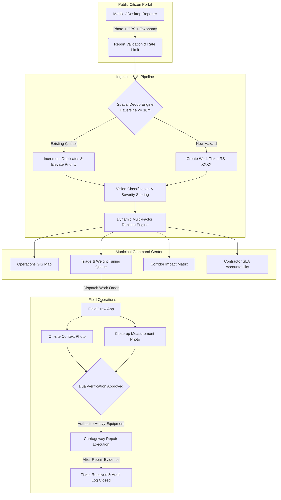

# 🛣️ RoadSense

> **Municipal Road Maintenance Intelligence & Citizen Reporting Platform**  
> Streamlining civic hazard reporting, spatial deduplication, AI-assisted triage, and field crew dispatch for modern cities.

## 📌 Executive Summary

Municipal road maintenance faces persistent bottlenecks: citizen frustration over unacknowledged reports, duplicate complaints overwhelming municipal call centers, ambiguous severity assessments, and fragmented communication with field crews. 

**RoadSense** is a full-lifecycle municipal road management platform that bridges citizens, city operations engineers, and field repair crews into a single, cohesive system:

- 📸 **Citizens** easily submit photo-backed hazard reports with precise geolocation and receive immediate tracking references.
- 🧠 **Municipal Operators** leverage AI-driven classification, 10-meter spatial deduplication, customizable multi-factor priority weighting, and real-time SLA accountability.
- 🚜 **Field Crews** receive guided mobile task assignments with two-step chain-of-custody photo verification and dimensional measurement before heavy machinery is deployed.

---

## 🚀 Key Features & Capabilities

### 1. 📱 Citizen Reporting Portal (`/` or `/report`)
- **4-Step Guided Workflow**:
  1. **Photos**: Attach up to 3 high-resolution images (JPG, PNG, WebP) directly from camera or device storage (with client-side size & format validation).
  2. **Location**: Auto-detects device coordinates via HTML5 Geolocation API with graceful fallback to an interactive Leaflet draggable map pin.
  3. **Category**: Quick taxonomy tagging (Pothole, Standing Water / Flooding, Road Crack, Debris, Broken Manhole Cover, Missing Signage, Other).
  4. **Review & Privacy**: Explicit privacy guidance warning against capturing faces or license plates before final submission.
- **Immediate Confirmation**: Generates a persistent civic reference code (`RS-XXXX`) for transparency.
- **Client-Side Anti-Spam & Geofencing**: Automatically clusters submissions within 10 meters of existing issues to increment duplicate counts rather than create fragmented tickets.

### 2. 🗺️ Command Operations Map (`/map`)
- **Interactive GIS Exploration**: Powered by Leaflet & OpenStreetMap, displaying clustered hazard markers color-coded by severity (High, Medium, Low).
- **10-Meter Geofence Visualizer**: Toggleable circular geofences illustrating deduplication zones.
- **Multi-Dimensional Filtering**: Real-time filtering by district (Central, East, West), hazard type, and severity.
- **Detail Inspector Drawer**: View AI confidence score, SLA deadline countdown, linked duplicate complaints, and hazard priority scores.
- **🌦️ Extreme Weather Simulation Overlay**:
  - Simulates heavy rainfall conditions across the city.
  - Automatically flags edge cases (e.g., differentiating deep potholes from shallow surface puddles based on depth cues vs. water reflection).
  - Automatically routes low-confidence detections to human operator review, preventing inaccurate automated dispatches.

### 3. ⚡ AI Pipeline & Dynamic Triage (`/triage`)
- **Live 6-Stage Pipeline Tracker**: Real-time visibility into `Ingest` ➔ `Vision Classification` ➔ `Spatial Dedup` ➔ `Severity Scoring` ➔ `Auto-Triage` ➔ `Dispatch`.
- **Interactive Spatial Deduplication Demo**: One-click simulation merging 10 concurrent citizen complaints within a 10m radius into a single actionable work order.
- **Configurable Priority Weight Sliders**: Operators dynamically tune the scoring model by adjusting weights for:
  - Hazard Severity
  - Duplicate Complaint Volume
  - Commercial Corridor Economic Impact
  - SLA Age & Escalation
- **Live Civic Telemetry Feed**: Real-time event log with interactive pause/resume functionality.
- **Historical Triage Metrics**: Recharts interactive area graph showing triage acceleration from 48–72 hours down to 4.2 minutes (includes an accessible data table toggle).

### 4. ⏱️ Contractor SLAs & Accountability (`/triage?tab=sla`)
- **Active Repair Pipeline**: Step-by-step progress tracking for every active work ticket (`Reported` ➔ `Verified` ➔ `Crew Dispatched` ➔ `Resolved`).
- **SLA Breach Warnings**: Visual indicators distinguishing `On track`, `At risk` (<8 hours remaining), and `Breached` tickets.
- **Contractor Leaderboard**: Tracks district-level municipal contractors (CivicWorks Ltd., Metro Roadcare, UrbanFix Services) comparing on-time completion rates, average resolution speed, and SLA breaches.

### 5. 🏙️ Commercial Corridor Prioritization (`/corridors`)
- **Economic & Civic Impact Modeling**: Directs road crews to arterial routes where road failures inflict the highest commercial and commuter cost.
- **Multi-Factor Ranking Matrix**: Evaluates corridors against Business Density, Foot Traffic, Delivery Route Volumes, Severity, and SLA Age.
- **Impact Projections**: Models estimated reductions in commercial delivery delays and impacted merchant disruptions.

### 6. 👷 Field Crew Simulator (`/crew`)
- **Mobile-First Field Experience**: Tailored viewport for field engineers and contractor crews on-site.
- **Turn-by-Turn Routing**: One-tap navigation trigger to reach the reported hazard coordinates.
- **Mandatory Two-Step Chain-of-Custody**:
  1. *Site Context Photo* capturing the hazard and surrounding carriageway.
  2. *Secondary Verification Photo* with close-up depth (mm) and width (cm) dimensional inputs.
- **Simulated Network Resilience**: Demonstrates offline/network retry handling during field uploads.
- **Authorization & Resolution**: Heavy equipment can only be authorized once dual evidence is captured, followed by before-and-after photo resolution.

### 7. ♿ Accessibility & Universal Design (`/accessibility`)
- Built in alignment with **WCAG 2.2 Level AA** standards.
- Fully navigable via keyboard with visible focus indicators.
- Semantic HTML5 landmarks, ARIA labels, live announcement regions (`aria-live="polite"`), and skip links.
- High-contrast typography and non-color-dependent status indicators.
- Respects system-level `prefers-reduced-motion` settings.

---

## 🔑 Demo Access Credentials

The platform includes built-in role switching and authentication simulation:

| Role | Access URL | Credentials | Key Tasks |
| :--- | :--- | :--- | :--- |
| **Citizen (Public)** | `/` or `/report` | *No credentials needed* | Submit photo reports, select hazard type, verify map pin |
| **Municipal Operator** | `/login/operator` | **Email:** `operator@roadsense.gov`<br>**Password:** `Operator@123` | Operations GIS map, triage pipeline, SLA leaderboard, corridor prioritization |
| **Field Crew** | `/login/crew` | **Crew ID:** `CREW-017`<br>**PIN:** `4821` | Receive assigned task, upload 2-step verification photos, authorize equipment |

---

## 🏗️ System Architecture



---

## 📁 Repository Structure

```text
RoadSense/
├── public/                 # Static assets and icons
├── src/
│   ├── app/
│   │   └── routes.tsx      # React Router configuration & role-guarded routes
│   ├── components/
│   │   ├── AppShell.tsx    # Command center dashboard layout, sidebar, & demo walkthrough
│   │   ├── CrewShell.tsx   # Mobile layout & navigation for field crews
│   │   ├── PublicShell.tsx # Public citizen header, breadcrumbs, & role links
│   │   ├── LocationPicker.tsx # Draggable Leaflet map pin for report location
│   │   ├── MapView.tsx     # Operations GIS map with custom Leaflet markers & geofences
│   │   ├── RoleGuard.tsx   # Route protection based on user role
│   │   └── ui.tsx          # Reusable design system primitives (Cards, Buttons, Badges)
│   ├── context/
│   │   ├── AuthContext.tsx # Authentication state (Operator / Crew / Public)
│   │   ├── DemoContext.tsx # Centralized live reports store, weather toggle, & reset
│   │   └── ReporterContext.tsx # Citizen report submission, clustering, & rate-limiting
│   ├── data/
│   │   └── mockData.ts     # Seed datasets: hazards, reports, corridors, SLA leaderboard
│   ├── pages/
│   │   ├── AccessibilityPage.tsx # WCAG 2.2 AA accessibility statement & conformance
│   │   ├── CorridorsPage.tsx     # Commercial corridor economic prioritization
│   │   ├── CrewLoginPage.tsx     # PIN-based login for field teams
│   │   ├── CrewPage.tsx          # Mobile 2-step field verification simulator
│   │   ├── MapPage.tsx           # Full GIS map with weather simulation & detail drawer
│   │   ├── OperatorLoginPage.tsx # Municipal operator command authentication
│   │   ├── ReportPage.tsx        # 4-step citizen hazard reporting wizard
│   │   └── TriagePage.tsx        # Pipeline visualization, weight tuning, & SLA tracking
│   ├── services/
│   │   └── api.js          # Asynchronous mock API service with realistic latencies
│   ├── App.tsx             # Root React component wrapping providers
│   ├── index.css           # Design tokens, theme styling, & Tailwind v4 layers
│   └── main.tsx            # Application entrypoint
├── index.html              # HTML shell with accessibility landmarks & viewport configuration
├── package.json            # Scripts and dependencies
├── tsconfig.json           # TypeScript configuration
└── vite.config.ts          # Vite build tooling with React and Tailwind v4 plugins
```

---

## 💻 Tech Stack

| Category | Technology | Description |
| :--- | :--- | :--- |
| **Framework** | [React 19](https://react.dev/) | Component architecture and modern concurrency |
| **Language** | [TypeScript 5.7](https://www.typescriptlang.org/) | Type-safe enterprise code quality |
| **Build Tooling** | [Vite 8](https://vitejs.dev/) | Lightning-fast HMR and optimized bundler |
| **Styling** | [Tailwind CSS v4](https://tailwindcss.com/) | Modern utility-first styling with custom CSS design tokens |
| **Routing** | [React Router v7](https://reactrouter.com/) | Client-side routing with role-based guards |
| **GIS & Mapping** | [Leaflet](https://leafletjs.com/) + [React Leaflet](https://react-leaflet.js.org/) | Geospatial visualization, geofences, and pin placement |
| **Data Visualization** | [Recharts 3.10](https://recharts.org/) | Responsive charts for triage trends and performance metrics |
| **Icons** | [Lucide React](https://lucide.dev/) | Clean, accessible iconography |
| **Formatting** | [oxfmt](https://github.com/oxc-project/oxc) | Blazing-fast code formatting |

---

## 🛠️ Getting Started

### Prerequisites
- **Node.js**: v18.0.0 or higher
- **Package Manager**: `npm` or `pnpm`

### Installation

1. **Clone the repository:**
   ```bash
   git clone https://github.com/your-org/RoadSense.git
   cd RoadSense
   ```

2. **Install dependencies:**
   ```bash
   npm install
   # or
   pnpm install
   ```

3. **Start the local development server:**
   ```bash
   npm run dev
   # or
   pnpm dev
   ```

4. **Access the application:**
   Open your browser and navigate to `http://localhost:5173` (or the port displayed in your terminal).

---

## 📜 Available Scripts

- `npm run dev` — Starts the Vite development server with hot-module reloading.
- `npm run build` — Compiles TypeScript and builds production bundles into `dist/`.
- `npm run preview` — Locally previews the production build.
- `npm run format` — Formats source files using `oxfmt`.

---

## 🛡️ Privacy & Civic Compliance

- **No Personal Identifiable Information (PII) on Public Records**: Reports store only coordinates, timestamps, hazard taxonomy, and road images.
- **Photo Privacy Check**: The citizen reporting flow explicitly advises reporters to avoid capturing faces and vehicle registration plates.
- **Municipal Chain-of-Custody**: All status transitions (`Reported` ➔ `Verified` ➔ `Dispatched` ➔ `Resolved`) maintain an immutable sequence to ensure auditability.

---

## 📄 License

This project is licensed under the MIT License — see the [LICENSE](LICENSE) file for details.
